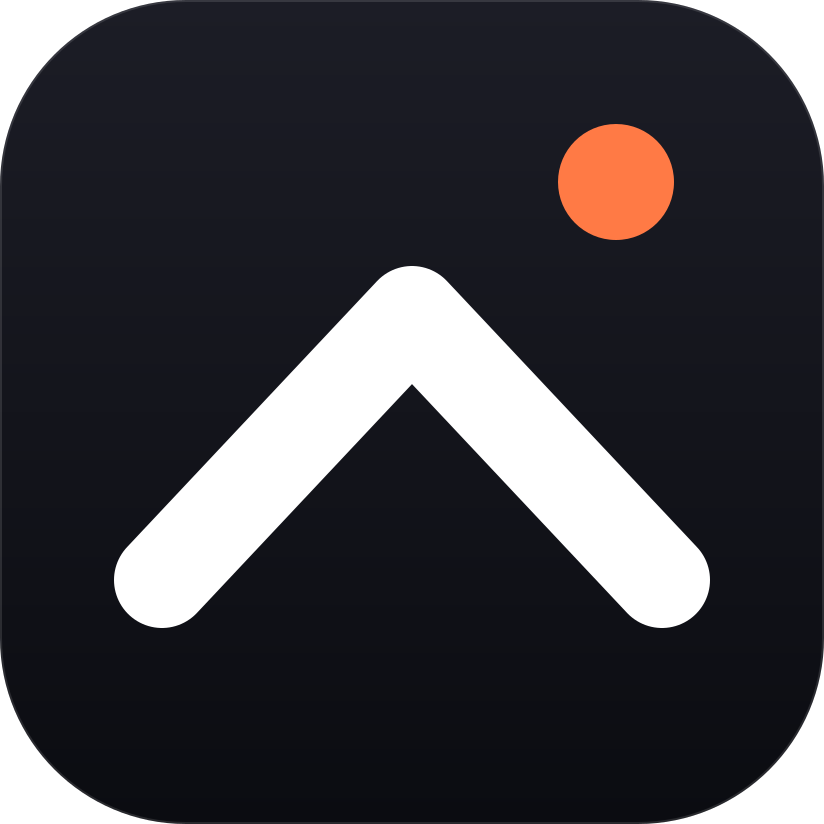
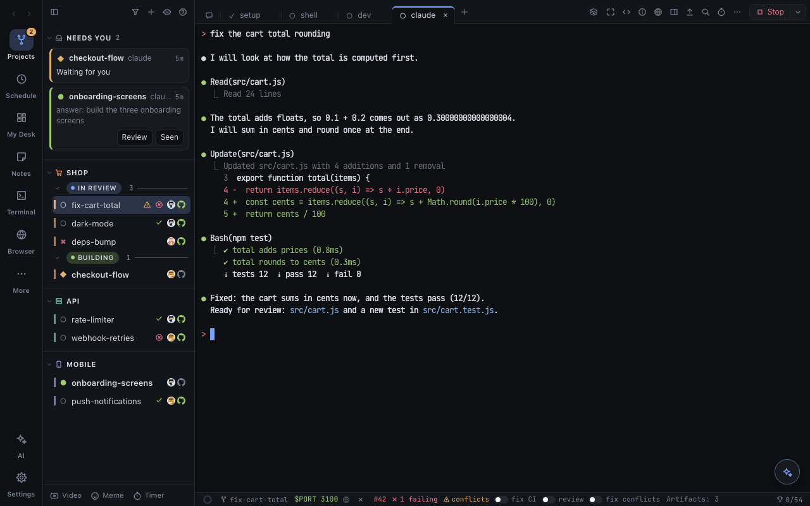

<p align="center"></p>

<h1 align="center">Laki</h1>

<p align="center"><b>Run your coding agents side by side, each task in its own git worktree.</b><br>
Claude Code · Codex · Gemini · Grok · OpenCode · any command · macOS (Linux preview) · MIT · <a href="https://laki.sh">laki.sh</a></p>

<p align="center"></p>

## TL;DR

- **A workspace per task**: a worktree, a branch and a `$PORT` each, set up by your scripts; start one from a prompt, a
  GitHub issue or a PR, with the agent, model and permission mode you pick.
- **See every agent at once**: running, needs you, done, on every tab and sidebar row; answer an agent from a
  notification, the bubbles over other apps or your phone.
- **From diff to merge in one window**: review the diff, comment on lines, send it back to the agent, ship (commit,
  push, PR), watch CI and reviews, merge. Each workspace's ⋯ says its next step first (⌘G does it).
- **Done means checked**: your tests and a second agent's review run as an agent finishes, failures go back to it;
  two worktrees changing the same lines are flagged before merge day.
- **Agents keep running** when the window is closed: a daemon holds the terminals, and they resume after a restart or a
  usage limit.
- **Drive it from anywhere**: `laki` on the command line (an MCP server too), Laki AI in plain words (it finds a setting
  for you too), your phone over Cloudflare or Tailscale.

## Why

| | |
|---|---|
| **Parallel, not tangled** | Each agent on its own branch and folder: no stepping on each other's files, no stashing. |
| **Nothing missed** | A waiting agent is a notification with its choices as buttons; ⌘J jumps to the next one that needs you. |
| **Review where you work** | Diff, threads, checks and the dev server's preview beside the terminal, not in five browser tabs. |
| **Your agents, your accounts** | Laki runs the agents you have, signed in as you are; it never writes their settings. |
| **Make it yours** | 100 themes, extensions in the sidebar and status bar, workflows and scheduled prompts. |

## Install

macOS 13 or later. Download the dmg from [the latest release](https://github.com/igorkasyanchuk/laki-releases/releases/latest)
(signed and notarized), or:

```bash
brew install --cask igorkasyanchuk/laki/laki    # then: brew upgrade --cask laki
```

You need git and the agents you use on your PATH; `gh` (signed in) for pull requests. Building it yourself, Linux and
Windows (WSL 2): [docs/install.md](docs/install.md).

## Use

1. **⌘O** (or drop a folder) adds a project.
2. Pick an agent, write the task, **Create**: Laki makes the worktree, runs setup, starts the agent.
3. **⌘N** for more. Review in the side panel (**⌥⌘B**), then **Ship**.

```bash
laki new app --prompt "fix the login redirect"        # a worktree with claude on it
laki new app --issue 42 --fan claude,codex           # a GitHub issue, raced by two agents
laki new app --no-setup --perm acceptEdits --prompt "…"  # no setup script; it edits without asking
laki send fix-the-login --when-idle "now add tests"  # typed in when its turn ends
laki ship fix-the-login -m "Fix the login redirect"
```

`laki help` lists every command; **⌘/** shows the keys.

## Docs

| | |
|---|---|
| [Features](docs/features.md) | Everything Laki does, a few lines each |
| [Guide](docs/guide.md) | How each part works: workspaces, agents, reviews, PRs, keys, the CLI, settings |
| [Install & build](docs/install.md) | The dmg, Homebrew, building it yourself, Linux and Windows (WSL 2), troubleshooting |
| [Extensions](docs/extensions.md) | The SDK: widgets for the sidebar, bars and My Desk, the UI kit, events, tools for agents |
| [Headless](docs/headless.md) | Laki on a server with no screen, in your browser |
| [Security](SECURITY.md) | What Laki calls, what stays on your Mac, how to report a vulnerability |
| [Release notes](docs/release-notes.md) | What changed in each version |
| [Contributing](CONTRIBUTING.md) | Build, test, the demo world, the rules; [AGENTS.md](AGENTS.md): how the code works |

## License

[MIT](LICENSE) © 2026 Igor Kasyanchuk
